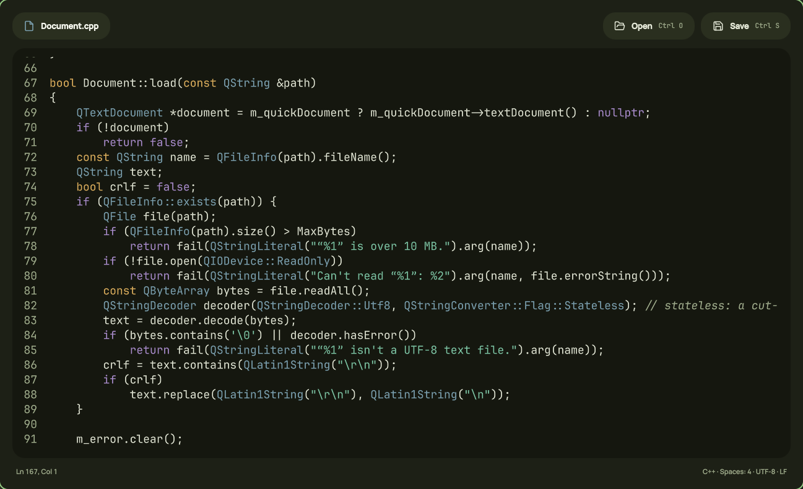

<div align="center">
  

  # Pistachio Text

  A lightweight text and code editor for Linux, styled to match Pistachio Noir.
</div>

Pistachio Text is a single-document desktop editor built with Qt Quick (QML) and C++. It uses KDE's KSyntaxHighlighting for language-aware colours and provides matching Open and Save as dialogs.

## Showcase



## Features

- Syntax highlighting for languages supported by KSyntaxHighlighting
- Open, edit, and save one file at a time
- Find and Go to line controls
- Indentation-aware Enter and Tab behavior
- Preserves LF and CRLF line endings
- Rejects non-UTF-8 files and files larger than 10 MB
- Linux desktop entry and scalable application icon

## Requirements

- Meson, Clang, CMake (for discovering KF6)
- Qt 6.9 or newer: Core, Gui, Qml, Quick, and Test
- KF6 Syntax Highlighting
- Ninja

## Build and run

```sh
CC=clang CXX=clang++ meson setup build-meson --prefix="$HOME/.local"
meson compile -C build-meson
./build-meson/pistachio-text [file]
```

Install to `~/.local`:

```sh
./install.sh
```

The install includes the application, desktop launcher, and icon. To set it as the default plain-text editor:

```sh
xdg-mime default pistachio-text.desktop text/plain
```

## Keyboard shortcuts

| Shortcut | Action |
| --- | --- |
| `Ctrl+O` | Open a file |
| `Ctrl+S` | Save; prompts for a name on a new document |
| `Ctrl+Shift+S` | Save as |
| `Ctrl+F` | Find; `Enter` goes to the next match, `Shift+Enter` to the previous, `Esc` closes |
| `Ctrl+G` | Go to line |
| `Ctrl++` / `Ctrl+-` / `Ctrl+0` | Increase, decrease, or reset text size |
| `Ctrl+mouse wheel` | Zoom text |
| `Ctrl+W` / `Ctrl+Q` | Close; asks about unsaved changes |

In the file dialogs, use the Up and Home buttons to navigate, or press Ctrl+L to enter a folder path. Save as also accepts paths relative to the current folder. In Open, typing filters the list; enter an absolute path or a path beginning with `~` to navigate. Use Up/Down to select, Enter to open, Esc to close, and Ctrl+H to show hidden files.

## Development checks

```sh
meson test -C build-meson --print-errorlogs
QT_QPA_PLATFORM=offscreen build-meson/ptx-shots build-meson/shots
```

The screenshot check writes images to `build-meson/shots/`. `TESTING.md` lists additional manual checks.

## Project layout

- `src/` — document handling, syntax highlighting, and file listing
- `qml/` — editor window, dialogs, controls, and theme
- `data/` — desktop entry and application icon
- `tests/` — Qt tests and screenshot checks
- `design/` — design boards

## License

Pistachio Text is licensed under the GNU General Public License v3.0 only. See [LICENSE](LICENSE).

## Development note

This app was written with the assistance of Claude Code.

Shared colours (18 November 2026, owner’s call): follows `~/.config/pistachio/shared-theme` (`pistachio` or `noir`) live, including atomic replacements. Respects XDG_CONFIG_HOME; missing or invalid files use Pistachio Noir. The shell publishes the selection.
